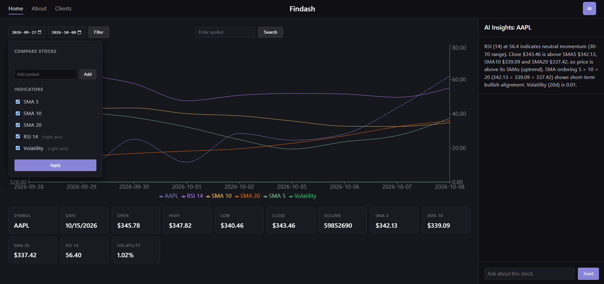

# Findash - AI Financial Insights Dashboard
End to end React dashboard providing information about public investment markets and client profiles with AI insights. Created with Bicep IaC from day one. 

**Business Application:** a tool for financial advisors. Advisors manage clients and their portfolios with AI generating reports based on  holdings and risk. Users are abke to see stock information and indicators as well. 

Live demo: https://blue-sand-0d706770f.4.azurestaticapps.net (sign-in by invite)

## Architecture 
Browser → SWA (React/TS) → APIM Consumption gateway (JWT validation + shared-key injection) → AKS ingress (nginx) → FastAPI pod (workload identity) → 
Azure SQL (Entra federated) → Azure OpenAI (gpt-5-mini, managed identity) → Key Vault (shared secret)

Timer → Azure Functions (ingestion) → ADLS Gen2 bronze/silver/gold → Azure SQL

[Diagram](./docs/Findash-model.drawio.png)

### Workflows ('.github/workflows/'):
- 'infra-pr.yml' runs 'bicep what-if' on PRs touching 'infra/**'. Catches accidental resource deletions before merge instead of after.
- 'infra-deploy.yml' deploys on push to main at subscription scope, since 'main.bicep' creates its own resource group. The APIM shared secret is injected inline from an Actions secret rather than living in the committed '.bicepparam'.
- 'web-deploy.yml' builds and deploys the React app to Static Web Apps on changes to 'src/web/**'. This is the only workflow using a stored credential, since SWA requires a deployment token instead of OIDC.
- 'aks-autostart.yml' and 'aks-autostop.yml' run the cluster roughly 7am to midnight Mountain Time. Both check 'powerState.code' before acting, so a run is only red when something actually failed. Node uptime is the single largest cost lever in the architecture.

## API Endpoint Reference
| Method | Route | Auth | Returns |
|---|---|---|---|
| GET | /v1/market/{symbol} | Bearer + APIM header | Latest OHLCV plus computed indicators |
| GET | /v1/market/{symbol}/history | Bearer + APIM header | Full daily series, optional start and end |
| GET | /v1/advice/brief/{symbol} | Bearer + APIM header | AI technical-posture summary with as-of date |
| GET | /v1/advice/ask/{question} | Bearer + APIM header | Grounded answer via OpenAI function calling |

## Limitations
- Sign in is by invite. Tenant is single tenant, external users need a B2B guest invitation.
- Data refreshes once daily. Alpha Vantage free tier caps at 25 requests a day against a 14 stock watchlist, so there is little headroom for re runs.
- The AI brief calls the model live on each click. First call after a cold start takes 3 to 5 seconds.
- Clients page uses hardcoded sample data.
- Chart date filtering is client side over the full history payload. Fine at current data volume, would need server side ranges at scale.

## Phases
### Phase 1
- Created Entra app registration with service principal (scoped to subscription), 2 federated credentials implemented for 'Pull request' and Deploy for Github Actions OIDC
- [Main](./infra/main.bicep) - Scoped to subscription to deploy resource group, budget, and log analytics workspace
- CI/CD 
    - 'infra-pr.yml' - runs 'bicep-deploy' what-if check on every PR
    - 'infra-deploy.yml' - deploys to azure automatically on merge to 'main'

### Phase 2 
- Deployed ADLS Gen2 storage (bronze/silver/gold containers), Key Vault (RBAC-mode), Azure SQL serverless (Entra-only auth) via Bicep, region adjusted for PAYG subscription restrictions (SQL + Function App on 'westus2', rest on 'eastus')
- [IngestionFunctions](./IngestionFunctions) - Python Function App (v2 model on Linux Consumption plan), system-assigned MI, zero connection strings
    - Ingests a watchlist of 14 tickers (AAPL, MSFT, GOOGL, AMZN, NVDA, META, TSLA, IBM, JPM, V, WMT, DIS, KO, NFLX). The pipeline maintains the data in SQL where
    - 'AlphaVantageIngest' - timer-triggered daily, loops through the ticker list to retrieve symbols OHLC, lands raw JSON in 'bronze/AlphaVantage/' blob storage
    - 'bronze_to_silver' - cleans raw JSON into structured OHLCV using pandas, lands Parquet in 'silver/AlphaVantage/{ticker}'
    - 'silver_to_gold' - computes SMA/RSI/volatility from silver, writes to 'gold/AlphaVantage/{ticker}_technical_indicators.parquet' and Azure SQL (Entra auth, no passwords)
    - Data lake organization: one Parquet file per symbol at each layer. The SQL serving table is a single 'Technical_indicators' table with all symbols stacked with primary key bring Symbol and Stock_date
    - Full RBAC permissions given using least privilege principle: Blob/Queue/Table Data Contributor, Key Vault Secrets User, Monitoring Metrics Publisher, all scoped to the Function App's MI. SQL access granted via 'CREATE USER ... FROM EXTERNAL PROVIDER' + db_datawriter/db_datareader roles
    - Storage connection string auto-generated via 'listKeys()' and stored as a Key Vault secret. Its being referenced by the app via '@Microsoft.KeyVault(SecretUri=...)' so no raw secrets on the resource itself

### Phase 3 
- [Web](./src/web) React + TypeScript frontend scaffolded with Vite
    - Symbol search box (controlled input), error handling, and a formatted table of prices, RSI, and volatility
    - MSAL wired in for Microsoft login (loginRedirect + PKCE flow), acquires access tokens and sends them as Bearer tokens on API requests
- [API](./src/api) containerized FastAPI service serving gold layer technical indicators from Azure SQL as JSON
    - '/market/{symbol}' endpoint with parameterized queries (SQL injection safe), error handling (404), and Entra token auth to SQL via 'DefaultAzureCredential' (no passwords)
    - Dockerfile hardened with multi stage build (builder + runtime stages) and non root user, pinned to 'python:3.11-slim-bookworm' with ODBC Driver 18
    - 'auth.py' validates incoming JWT tokens with python-jose: signature (using Entra's JWKS keys), audience, issuer, and expiry are used to AUTHORIZE. Unauth'd requests return 401
- Identity
    - 2 app registrations: 'api-app' (exposes the 'access_as_user' scope) and 'spa-app' (granted that scope as a delegated permission)(both configured on entra)
    - App roles 'Advisor' and 'Client' defined on 'api-app' for future role-based data filtering

### Phase 4 
- [ACR](./infra/modules/platform/acr.bicep) Basic tier container registry (admin user disabled), stores the API image
- [AKS](./infra/modules/platform/aks.bicep) cluster 'findash-aks-dev' on the Free tier, one node, OIDC issuer and workload identity enabled, managed NGINX ingress via the app routing add on
    - AKS kubelet identity granted AcrPull on the registry so the cluster pulls images with no stored credentials
- [Kubernetes manifests](./deploy) Deployment, Service (ClusterIP), and Ingress (public IP). The API runs as a pod reachable from the internet through the ingress
- [Workload identity](./infra/modules/security/workloadidentity.bicep) user assigned managed identity 'podIdentity' federated to the Kubernetes service account 'findash-api-sa'. The pod authenticates to Azure SQL with a federated token and zero secrets in the cluster, using the same 'DefaultAzureCredential' pattern
- CI/CD
    - 'aks-autostop.yml' nightly GitHub Actions workflow (cron, OIDC login) that runs 'az aks stop' to control cost

### Phase 5
- [Azure OpenAI](./infra/modules/ai/openai.bicep) account 'gurbosopenai' deployed via Bicep with a gpt 5 mini model deployment
    - 'podIdentity' granted the 'Cognitive Services OpenAI User' role, so the API calls the model passwordless via 'DefaultAzureCredential'
- AI endpoints in [the API](./src/api)
    - '/advice/brief/{symbol}' gives a symbol's computed metrics to the model, which describes the stock's technical posture. Returns the message with up to date date and a not financial advice disclaimer
    - '/advice/ask/{question}' natural language Q and A using OpenAI function calling. Based on the question, the model decides when it needs data. When it does, it calls the 'get_metrics' tool and the API runs the SQL query and provides the result back.
- Design principle: the AI only tells users about numbers the pipeline computed. It never creates its own values, predicts prices, or gives buy/sell advice. Disclaimers are on every AI response

### Phase 6
- APIM Consumption in front of AKS ingress with 'validate-jwt' policy (both v1 and v2 token versions accepted), named values used through by Key Vault references, and a 'set-header' policy that injects a shared secret that the pod validates. If AKS is hit, then it returns 403, and APIM signed hits succeed
- Private endpoint deployed and verified via 'az stack group create': VNet (10.50.0.0/16) with bidirectional peering to the AKS managed VNet, three private DNS zones ('privatelink.database.windows.net', 'privatelink.blob.core.windows.net', 'privatelink.vaultcore.azure.net') linked to both VNets, and three private endpoints (SQL/blob/vault). Pod resolved 'gurbosSqlServer.database.windows.net' to a '10.50.1.x' IP, verified through 'kubectl exec nslookup'. Stack was destroyed to control the dev cost; Bicep lives in 'infra/modules/network/' and is redeployable.
- Microsoft Defender for Cloud Foundational CSPM also enabled at subscription scope via Bicep

### Phase 7 
- Azure Static Web Apps Free tier, deployed via GitHub Actions on push to 'main'
- React + TypeScript + Vite + Recharts
- Clients page with sample advisor data exhibits general intended direction of the project

## Security posture
| Credential | Where it lives | How it is accessed |
|---|---|---|
| SQL access | Nowhere | Pod workload identity, federated token via DefaultAzureCredential |
| Azure OpenAI | Nowhere | Pod managed identity, Cognitive Services OpenAI User role |
| Storage access (Functions) | Nowhere | Function App system-assigned MI, Blob Data Contributor |
| APIM to AKS shared secret | Key Vault | APIM named value with Key Vault reference, pod reads via workload identity |
| Alpha Vantage API key | Key Vault | Function App reads via Key Vault reference in app settings |
| GitHub Actions to Azure | Nowhere | OIDC federated credential, two credentials scoped to PR and main separately |
| SWA deploy token | GitHub Actions secret | Required by the SWA action protocol, the only stored credential in the project |

## Incident Report
- AKS single node CPU saturation blocks system add ons like 'metrics-server' went into pending indefinitely because 'nginx-ingress' had 2 replicas. Both were requesting 500m CPU on a 1900m allocatable node. System pods were already claiming around 845m which left no room. I resolved this by scaling nginx to 1 replica.
- APIM XML quoting. Setting a variable with 'value="@{var jwt = (Jwt)context.Variables[“jwt”]; ...}”' fails because the inner “jwt” closes the attribute. I resolved this by escaping every inner quote as '“'.
- Bicepparam strict mode broke CI. I had removed the APIM shared key value from the committed '.bicepparam' to keep the secret out of Git. CI  failed with "BCP258: all params declared in 'main.bicep' must be assigned in a single '.bicepparam' file split files and CLI 'parameters key=value' overrides do not satisfy the check." I resolved this by giving a default the '@secure()' param to an empty string in 'main.bicep'. I then had to override via inline parameters block during the local CLI call.
- Private endpoint cross RG peering. VNet peering is directional. A peer in VNet A pointing at VNet B does not establish return traffic. The reverse peering (AKS managed VNet to 'findash-privnet') had to be created inside 'MC_rgFindashDev_findash-aks-dev_eastus', not the project RG. Solved this with a nested Bicep module scoped to 'resourceGroup(aksVnetRgName)'. Private DNS zones also had to be linked to both VNets so pods resolve '*.database.windows.net' to the private IP.
- Key Vault RBAC propagation difference on APIM named value creation. APIM's named value with a Key Vault reference failed with 'Caller is not authorized' because the role assignment had not propagated through Entra when the named value tried to resolve the secret. Fixed this with an explicit 'dependsOn: [apimKvRole]' on the named value resource in Bicep. ARM reported the role as created immediately, but Entra takes an extra 30 to 90 seconds.
- Entra v1 token issuer vs APIM v2 issuer. The default behavior for a custom API's app registration is to issue v1 access tokens with issuer 'https://sts.windows.net/{tenant}/'. The initial APIM 'validate-jwt' policy only accepted 'https://login.microsoftonline.com/{tenant}/v2.0', so valid tokens 401'd at the gateway. I needed accept both issuers and both audience formats ('api://{guid}' for v1, bare '{guid}' for v2) in the policy so they could both go through.
- AKS auto stop interferes with Bicep idempotent redeploys. The AKS resource's PUT fails with 'OperationNotAllowed: Operations are not allowed when the managed cluster is not in the Running power state' if a Bicep deploy touches an idle cluster. The nightly auto stop workflow means afternoon redeploys hit a stopped cluster so every session I had to cmd 'az aks start' before running the main Bicep deploy.

## Scope decisions and architecture tradeoffs
The following were deliberately deferred with documented reasons.

- Watchlist of 14 stocks stored in code over user supplied API keys that authenticate everytime they want data. Rejected the 'user provides their Alpha Vantage key' path as it breaks the pipeline (ingestion runs on a schedule, not per request), creates annoying onboarding experience, and storing third party API keys is a security issue.
- Rate limiting ('rate-limit-by-key') - was not supported on APIM Consumption SKU. The policy pattern was designed but requires standard+ tier (~$150/mo).
- Response caching -  APIM Consumption built in cache unavailable that required external Redis.
- Kubernetes NetworkPolicies - The cluster was provisioned without a network policy engine ('network-policy=none'). This would require recreating the cluster. In an enterprise build, the cluster would be built with '--network-policy azure', default deny ingress/egress per namespace, and explicit allow rules for ingress to API, API to SQL, API to OpenAI, and  API to Key Vault.
- Observability custom events - Azure Monitor OpenTelemetry was wired into FastAPI, env var was confirmed in the pod with the SDK initializing. Issues came when trying query's on Application Insights as telemetry doesn't reach the workspace. Debug was deferred. Function App's App Insights wiring is working.
- Completed Advisor feature - current Clients page is a UI demo with hardcoded sample clients. Real build would include SQL schema for clients/portfolios/holdings, CRUD endpoints, Entra app role based data filtering (which is currently in place but not used and can be included in the JWT claims), and risk profile mismatch detection is a v2 scope.
- RAG endpoint - Azure AI Search index  and a grounded retrieval is designed but not built. Also a v2 scope.
- AKS over App Service or Container Apps for the API. App Service would have hosted the FastAPI container with less setup, and Container Apps would have handled scaling with no cluster to manage. Chose AKS because Kubernetes is the knowledge gap I wanted to close: pods, services, ingress, probes, rolling updates, workload identity, and kubectl debugging. Costs more and takes longer than the alternatives, which is the point for a learning project. Project 1 covered the data plane with Databricks and ADF; this one covers the app plane.
- Validate JWT in APIM and again in the pod using defense in depth. If someone bypasses APIM, the pod rejects. Also lets local dev (‘DISABLE_APIM_CHECK=true’) work without needing APIM in the loop.
- Deliberate SKU cost tradeoffs: APIM Consumption over Developer ($50/mo saved), AKS Free control plane, nightly auto stop with Github Actions, private endpoint deployed and destroyed via deployment stack ($22/mo saved).
- Static Web Apps over App Service for the frontend - SWA Free tier handles React and Vite builds natively, deploys from GitHub Actions on every push, and gives a free public HTTPS URL. App Service would require a container image, a deploy pipeline, and $0 to $13 a month for the plan. SWA’s one limitation (deployment-token auth instead of OIDC) is one of the downsides.

